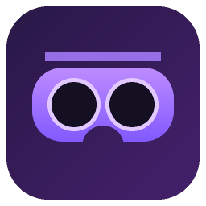
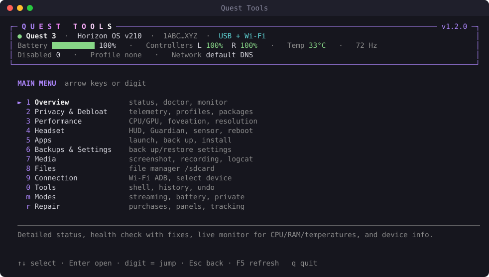
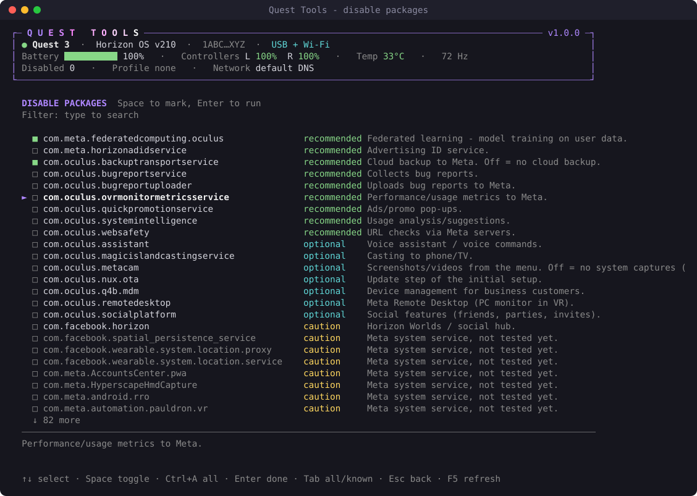

<p align="center">
  
</p>

<h1 align="center">Quest Tools</h1>

<p align="center">
  <b>Take back control of your Meta Quest 3 / 3S.</b><br>
  Debloat, kill telemetry, tune performance, back up save games and settings —<br>
  from a fast, good-looking terminal UI. Every change can be undone.
</p>

<p align="center">
  <a href="https://github.com/Hemiize/quest-tools/releases/latest"></a>
  
  
  
  
  <a href="LICENSE"></a>
</p>

<p align="center">
  
</p>

---

## ✨ Highlights

- **Menu-driven terminal UI**: arrow keys, hotkeys, type-to-filter, checklists. No commands to remember.
- **Live status bar** showing headset and controller battery, temperature, refresh rate, connection,
  disabled packages and active profile, plus warnings such as *TRACKING OFF*.
- **Undo for everything.** Every package toggle, property and setting change is journaled with its
  previous value, and one key reverts a whole operation.
- **Debloat that knows what it's doing.** A curated knowledge base marks packages as
  *recommended*, *optional*, *caution*, *keep* or *protected*. It never disables the services that
  break your home panels or purchased apps.
- **One-click repairs** for the classic debloat accidents: Store purchases gone, apps listed under
  *Unknown sources*, Store apps that won't install, missing home panels, dead controllers. Each fix
  is the procedure that actually worked on a real Quest 3.
- **Survives firmware updates.** Horizon OS updates silently switch your disabled packages back on.
  Quest Tools notices on the next start and offers to restore the pre-update state with one key,
  after taking a settings snapshot.
- **Backups that matter.** Settings snapshots with diff and selective restore, an **automatic safety
  snapshot** before every risky change, and app backups that include your **save games**
  (`/sdcard/Android/data` and `obb`).
- **Wi-Fi ADB that stays.** Finds the headset on your network when its IP changed, and can keep Wi-Fi
  ADB switched on: it is re-enabled automatically whenever the headset is on USB, e.g. after a reboot.
- **Sideloading with OBB data.** Drop an APK, an OBB or a whole game folder. Split APKs are installed
  together and OBB files land in `/sdcard/Android/obb/<package>/`.
- **Live view on your PC** via [scrcpy](https://github.com/Genymobile/scrcpy), cropped to one eye so it
  looks like a normal screen. The display stays on without wearing the headset.
- **Performance tuning.** CPU/GPU levels, fixed foveated rendering, eye-buffer resolution, refresh
  rate, presets and a live monitor.
- **Zero dependencies.** Pure Python standard library plus `adb`. Every function also works from the
  command line, including `--json` output.

## 🥽 Supported headsets

Quest Tools is made for the **Meta Quest 3** and **Meta Quest 3S**. Both run the same Horizon OS,
so every feature, profile and knowledge-base entry applies to both.

| Headset | Status |
|---|---|
| Meta Quest 3 | ✅ supported, tested (Horizon OS v209/v210) |
| Meta Quest 3S | ✅ supported (same OS and packages as the Quest 3) |
| Quest 2 / Quest Pro / other Android devices | ⚠️ not supported: generic ADB features may work, but Quest-specific functions and the package knowledge base are not tailored to them |

## 🚀 Quick start

**Requirements**
- A **Meta Quest 3 or 3S**
- Python **3.10+**
- Android platform tools (`adb`): [download](https://developer.android.com/tools/releases/platform-tools)
- *Optional:* [scrcpy](https://github.com/Genymobile/scrcpy) for the live view (`winget install Genymobile.scrcpy`)
- Developer mode enabled on the Quest (via the Meta Horizon phone app), with USB debugging allowed
  when the headset asks

**Get it**

```bash
git clone https://github.com/Hemiize/quest-tools.git
cd quest-tools
```

…or download the ZIP from the [latest release](https://github.com/Hemiize/quest-tools/releases/latest).

**Run it**

| Platform | |
|---|---|
| Windows | double-click **`Quest Tools.cmd`**. It opens its own terminal window |
| any | `python -m questtools` in the project folder |

Quest Tools finds `adb` on its own: the `adb_path` setting, then `QUESTTOOLS_ADB`, then `PATH`, then
`C:\platform-tools`, then the Android SDK.

## 🎮 Using the UI

| Key | Action |
|---|---|
| `↑` `↓` · `PgUp` `PgDn` · `Home` `End` | move |
| `Enter` | open / run |
| digit or letter in front of an entry | jump straight to it |
| `Esc` / `Backspace` | back one level |
| just type (in lists) | filter, e.g. `oculus` |
| `Space` · `a` | toggle · toggle all (checklists) |
| `Tab` | package list: switch between known and all packages |
| `F5` | refresh the status bar |
| `Ctrl+C` | stop a live view (monitor, logcat) |
| `q` | quit |

<p align="center">
  
</p>

### Menus

| | Menu | What's inside |
|---|---|---|
| 1 | **Overview** | status · health check · live monitor · device info · connected devices |
| 2 | **Privacy & Debloat** | telemetry report · check / apply profile (with dry run) · disable & enable packages from a checklist · full package analysis · explain a package · offline mode · Private DNS (AdGuard, Mullvad, Quad9, …) · save your own profile |
| 3 | **Performance** | current values · presets (battery → max) · CPU/GPU level · foveation (dynamic/fixed) · eye-buffer resolution · refresh rate · reset · process list · live monitor |
| 4 | **Headset** | FPS overlay · Guardian · proximity sensor · Phone SDK · SDK throttling · restart VR shell · reboot (normal/bootloader/recovery) · volume · key events · type text · open URL |
| 5 | **Apps** | apps sorted by size → details & permissions · launch · stop · backup with save game · export APK · per-app logcat · grant/revoke permissions · clear data · uninstall · install APK + OBB, files or a whole game folder (drag & drop) |
| 6 | **Backups & Settings** | settings snapshot · diff · selective/exact restore · app backups with save games · restore · browse settings |
| 7 | **Media** | screenshot (raw / wake headset / system) · screen recording · **live view on the PC** (scrcpy, one eye or both, optional recording) · filtered, colourised logcat |
| 8 | **Files** | arrow-key file browser · download · delete · upload · disk usage |
| 9 | **Connection** | one-step Wi-Fi ADB setup · **find headset on the network** · **keep Wi-Fi ADB on** · connect by IP · disconnect · pairing · choose device |
| 0 | **Tools** | adb shell · command library · change history · undo · run any command · configuration |
| r | **Repair** | check for known problems · fix Store purchases & installs · fix missing home panels · restore after a firmware update · fix dead tracking/controllers |

## 🛡️ How it keeps you safe

- **Journal & undo.** `pm disable/enable`, `setprop`, `settings put/delete` and system-app removals
  record the previous value in `%APPDATA%\questtools\journal.jsonl` (`~/.config/questtools`
  on Linux/macOS). *Tools → Undo* reverts any operation, even a full settings restore.
- **Knowledge base** (`questtools/kb.py`). Tested facts win over name patterns.
  `com.oculus.ocms`, `com.oculus.store` and `com.meta.credentialsmanager` are marked **keep**:
  without them the home panels or your purchased apps disappear. Those are skipped unless you
  pass `--force`. Protected packages such as `com.oculus.updater` are never attempted.
- **Automatic safety snapshots.** Before packages are disabled or settings are restored, a full settings
  snapshot is written (`settings-auto_…`, the last 10 are kept). Restore it like any other backup.
- **Dry runs everywhere.** Profiles, restores and performance changes can show what would happen
  before anything is touched.
- **Connection-safe restores.** `adb_enabled`, `adb_wifi_enabled`,
  `development_settings_enabled` and similar keys are never restored, so you can't lock yourself out.

**Built-in profiles**

| Profile | Disables |
|---|---|
| `telemetry` | telemetry, crash/bug-report uploaders, metrics, ad ID, promotions, federated learning, cloud backup |
| `privacy` | everything in `telemetry` plus unused Meta convenience services (assistant, social, casting, remote desktop, …) |

## 🩺 Troubleshooting

Open **r Repair → Check for problems** (or run `python -m questtools repair`) right after something goes
wrong. It checks package states, offline mode, running services and known error lines in the system
log, then names the fix.

| Symptom | Cause | Fix |
|---|---|---|
| Purchased apps disappear, show up under **Unknown sources** or say **"not purchased"** | `com.oculus.store` and/or `com.meta.credentialsmanager` disabled, so the purchase (entitlement) database is empty | **Repair → Store purchases & installs**: re-enables the store chain, refreshes the library and **reboots**. The full purchase sync only runs at boot; clearing the library app alone does not help |
| Store apps won't download or install | store chain disabled, or offline mode on | same repair. It also offers to switch offline mode off |
| Only passthrough and the system bar, no home, library or universal menu | `com.oculus.ocms` disabled (`Placement request Timeout` in the log) | **Repair → Home panels missing**: enables ocms and restarts the VR shell |
| After a Horizon OS update your disabled packages are active again | firmware updates reset package states | Quest Tools asks on the next start, or **Repair → After a firmware update**: disables them again (snapshot first) |
| Wi-Fi ADB gone after a reboot / IP changed | adb over Wi-Fi is switched off at every boot; DHCP may assign a new IP | **Connection → Keep Wi-Fi ADB on** (re-enabled whenever USB is plugged in) and **Find headset on the network** |
| Controllers and 6DoF tracking dead | the native tracking service crashed (DSP in a bad state) | **Repair → Controllers / tracking dead**: reboot. The service cannot be restarted from adb |

Quest Tools never disables `ocms`, `store` or `credentialsmanager` on its own. They are marked
**keep**, and forcing them prints an explicit warning.

## ⌨️ Command line

Every menu action is also a command, which makes it handy for scripts and automation:

```bash
python -m questtools status
python -m questtools doctor
python -m questtools debloat apply privacy --dry-run
python -m questtools settings backup -m "before experimenting"
python -m questtools settings restore --only secure,packages
python -m questtools perf preset performance
python -m questtools --json status          # machine-readable
python -m questtools repair store --dry-run
python -m questtools repair update             # after a firmware update
python -m questtools apps install "C:\Games\MyGame"   # APK + OBB folder
python -m questtools wifi find                 # find the headset on the LAN
python -m questtools wifi keep on
python -m questtools mirror --eye left         # live view (scrcpy)
python -m questtools undo
```

Global options: `-s SERIAL`, `--json`, `-y`. Changing commands accept `-n/--dry-run`.
See `python -m questtools --help` and `python -m questtools <area> --help`.

Backups, screenshots and videos go to `~/Quest/` (override with `QUESTTOOLS_OUT`). Configuration and
journal go to `%APPDATA%\questtools` (override with `QUESTTOOLS_HOME`).

## ⚠️ Limitations

- The Quest can't be rooted. `com.oculus.updater` and `com.oculus.q4bservice` cannot be disabled.
  To fully cut off Meta, use offline mode or a DNS filter on your router.
- Performance overrides (`debug.oculus.*`) reset on reboot.
- "Wake headset" screenshots can be black if the headset hasn't rendered a frame yet. They work
  best while you wear it.
- Internal app data (`/data/data`) is not readable without root. Save games stored under
  `/sdcard/Android/data` *are* backed up.
- Built for **Quest 3 / 3S**. Tested on a Quest 3 running Horizon OS v209/v210 under Windows. Newer
  firmware may rename or add packages, and Linux/macOS are less tested.

<details>
<summary><b>🗂️ Project layout</b></summary>

```
Quest Tools.cmd    double-click launcher (own window)
questtools/
  tui.py           interactive UI: header, menus, pickers, file browser
  term.py          keyboard input (arrows, Esc, …) and flicker-free drawing
  cli.py           command tree; no command → UI
  adb.py           find adb, pick device (USB before Wi-Fi), run/sh/batch
  ops.py           state-changing actions with journal + revert()
  store.py         configuration, journal, profiles, saved commands
  kb.py            knowledge base, classification, built-in profiles
  probe.py         full device status in a single adb call
  updates.py       firmware-update tracking and pending restores
  transfer.py      pull/push with progress (name, MB, %)
  ui.py            colours, tables, bars, prompts
  commands/        device, repair, debloat, perf, quest, apps, settings, net, media, mirror, files, backup, tools
tools/
  tuidemo.py       replay the UI with scripted keys (tests, screenshots)
  termshot.py      renders the SVG screenshots in this README
  make_icon.py     builds docs/questtools.ico
  glyphcheck.py    ensures only glyphs the Windows console font (Consolas) can draw are used
```
</details>

## ⚖️ Disclaimer

**Use at your own risk.** Quest Tools changes system packages, properties and settings on your
device through Android's developer interface (ADB). Although every change is journaled and
designed to be reversible, things can go wrong: features may stop working, apps or purchases may
temporarily disappear, data may be lost, or a device may need a factory reset.

- This software is provided **"as is", without warranty of any kind**, as stated in the
  [MIT License](LICENSE). The author (**hemiize**) is **not liable** for any damage to devices,
  loss of data, save games or purchases, account restrictions, or any other direct or indirect
  consequences of using it.
- Enabling developer mode and modifying system components may **affect your warranty** and may be
  restricted by the terms of service of the device manufacturer. You are solely responsible for
  making sure your use is permitted.
- **Back up first.** Use *Backups & Settings* to create a settings snapshot and back up your apps
  and save games before making changes.
- Only use Quest Tools on devices **you own or are authorised to manage**.
- The package knowledge base reflects observations on specific hardware and firmware. Package
  behaviour can change with any update.
- Quest Tools is an independent project and is **not affiliated with, endorsed or sponsored by
  Meta Platforms, Inc.** "Meta", "Meta Quest", "Oculus" and "Horizon" are trademarks of Meta
  Platforms, Inc. "Android" is a trademark of Google LLC. All trademarks belong to their
  respective owners.

## 👤 Author & license

Created by **[hemiize](https://github.com/Hemiize)** · [hemiize.xyz](https://hemiize.xyz)

Released under the [MIT License](LICENSE) – © 2026 hemiize.
You may use, modify and redistribute Quest Tools, as long as the copyright notice naming
**hemiize** is kept in all copies and derived works.
